# Zoom Tiles Generator

**Zoom into imaginary worlds like they're google maps. Explore middle earth like never before.**

Build and explore maps across zoom levels. Turn a text prompt into a searchable
knowledge atlas, pan through a fictional world such as Middle-earth, or edit
Earth map geometry and see the changes immediately. An optional local GPU worker
refines tiles in the background while the map stays usable.

**Repository status.** Private release staging. Public release is pending
redistribution rights for the Middle-earth source artwork and derived tiles.

## Middle-earth generated zoom tiles

The original Windows GTX 1060 run for the Shire is shown below. The source and
20-step GPU draft at tile `4/43/19` both match the SHA-256 hashes in the test
report.

| Original Shire tile | Generated Shire draft |
| --- | --- |
| 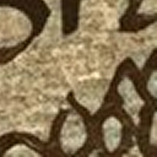 | 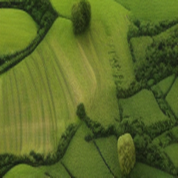 |

In a separate recursive test, each generated tile became the parent of the next
zoom. The images below are the actual outputs. The drafts add visible detail
and also introduce changes to lettering, color, and geography.

| Region | Native z2 | Generated z3 | Generated z4 | Generated z5 |
| --- | --- | --- | --- | --- |
| Erebor | 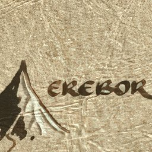 `2/20/3` | 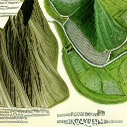 `3/40/7` | 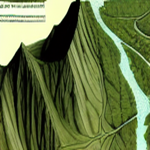 `4/80/14` | 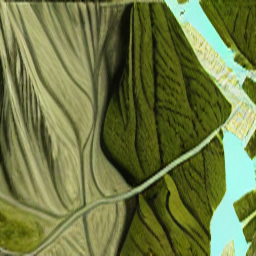 `5/161/29` |
| The Shire | 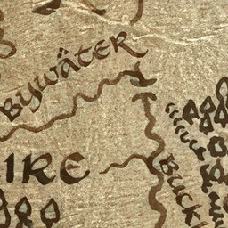 `2/11/4` | 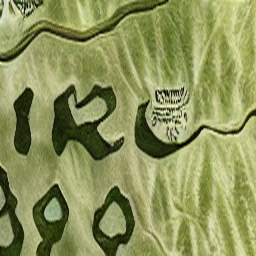 `3/22/9` | 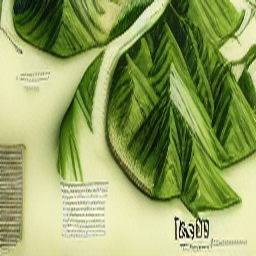 `4/45/19` | 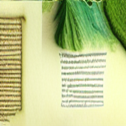 `5/90/39` |
| Southern interior | 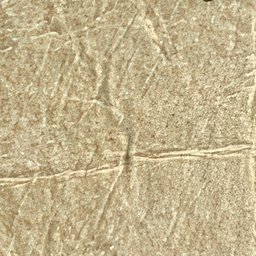 `2/18/14` | 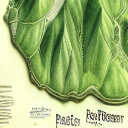 `3/36/29` | 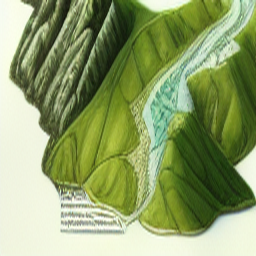 `4/72/58` | 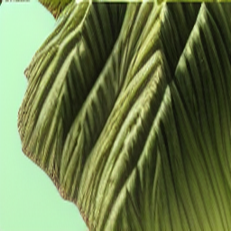 `5/144/116` |

Run `python scripts/serve_generation_results.py`, open the local results
viewer, then select **Middle-earth / Shire — default** and
**Source / generated comparison**. The recovered pair is included in this
checkout. You can also pan and zoom in World Explorer, then switch to
**Swipe original ↔ AI blended** near the Shire.
[Local results viewer](http://127.0.0.1:8795/generation-results.html) ·
[World Explorer demo](docs/TEXT_TO_WORLD.md) ·
[Generation tests and reproduction commands](docs/GENERATION_EVALUATION.md) ·
[Recorded results and hashes](examples/results/generation-evaluation.json)

Source artwork credit goes to Fraser Marlow’s Middle-earth fan map. These
images are included for private development review.

## Great Lakes across zoom levels

Five named Great Lakes become two fictional water bodies. The overview shows
the full edit. The detail captures follow the same point on the new Lake
America shoreline near Newmarket from regional to local-road scale.

| Before | After |
| --- | --- |
| 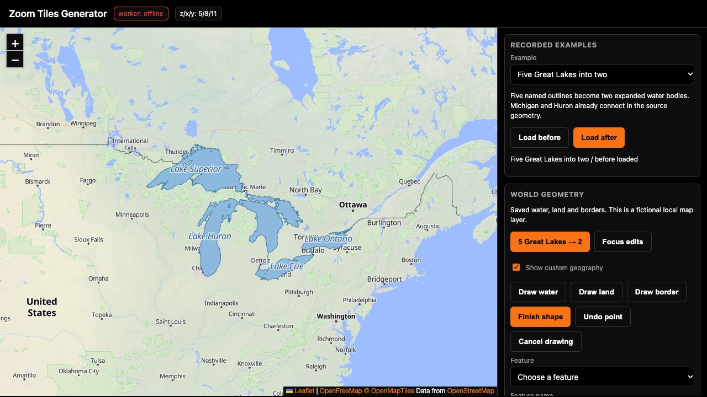 | 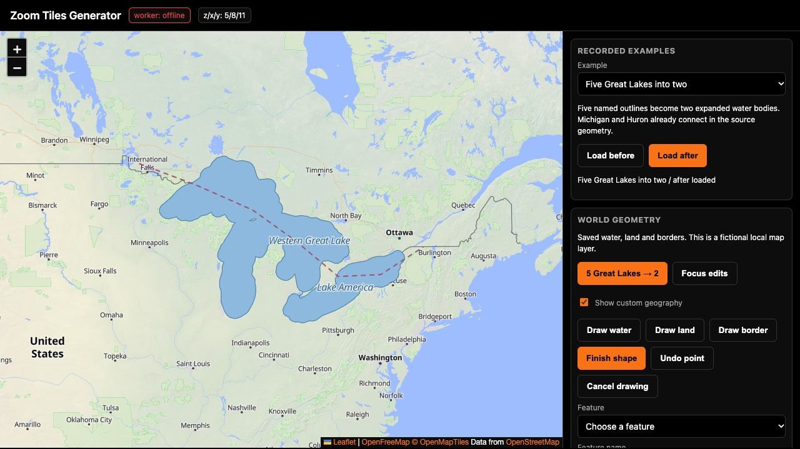 |

| Zoom 7 · Regional | Zoom 9 · Southern Ontario |
| --- | --- |
| 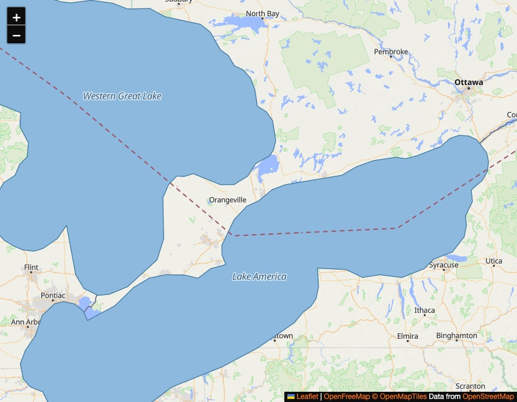 | 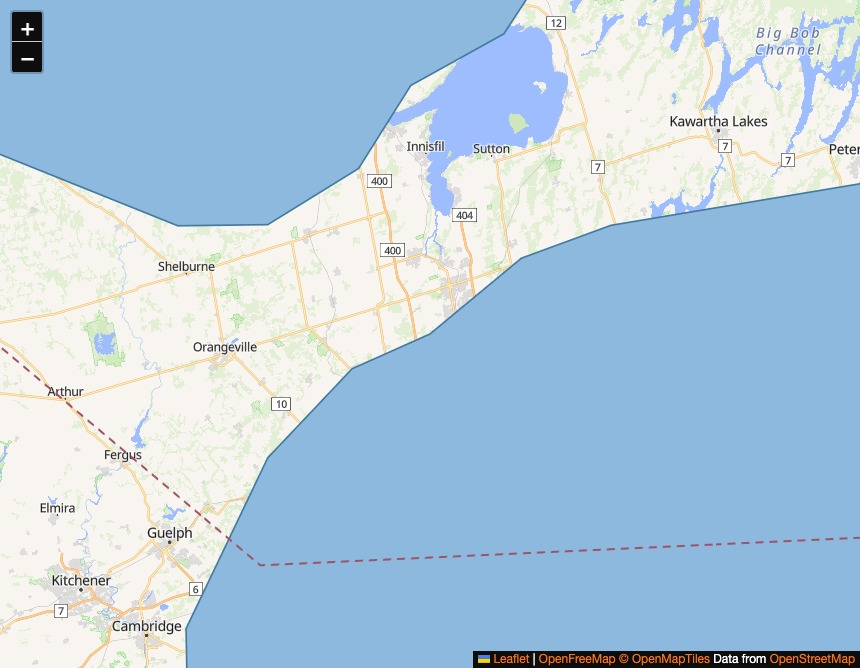 |
| **Zoom 11 · Newmarket area** | **Zoom 13 · Road detail** |
| 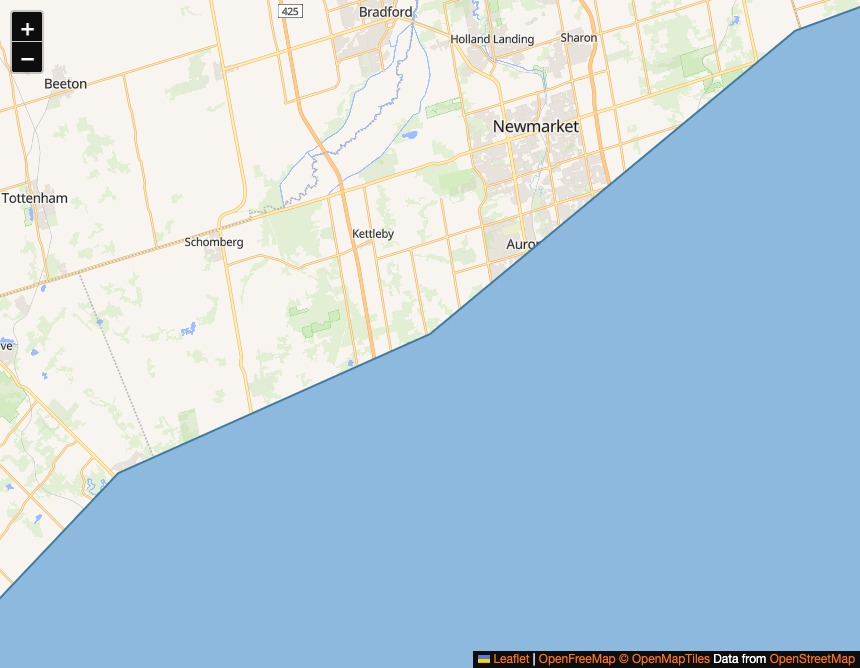 | 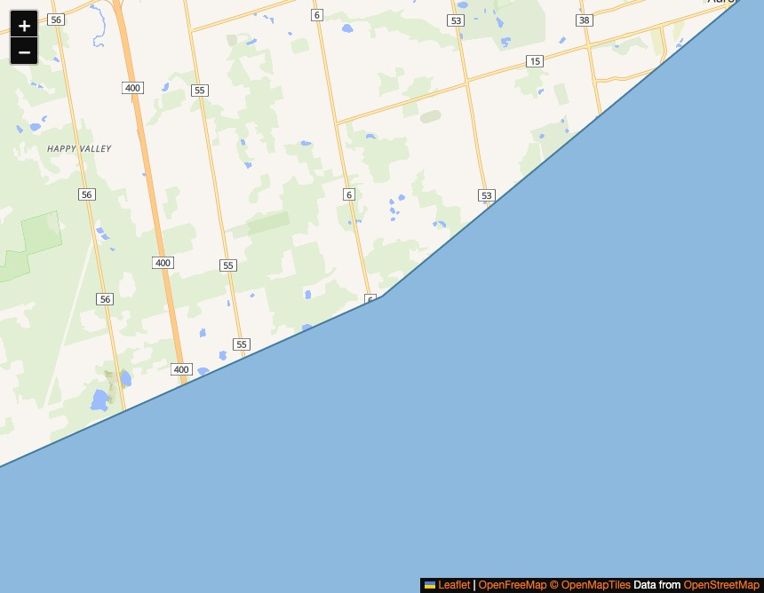 |

All four captures use the same center and saved geometry hash. The shoreline
stays anchored while the vector basemap reveals finer detail around it.
[Original map at the same zoom 11 camera](docs/images/great-lakes-before-z11.jpg) ·
[Camera positions and world hash](examples/results/navigation-recordings.json#L31) ·
[Run the Earth editing demo](#edit-earth-map-geometry)

## Quick start

Python 3.12+ and Node.js 22+ are the tested baseline. From the repository root,
create and activate a virtual environment for your shell, then install the project.

```sh
python -m venv .venv
# Activate .venv using your shell's normal command.
python -m pip install -e .
```

### Create and explore worlds

```sh
python scripts/serve_world_explorer.py
```

Open [World Explorer](http://127.0.0.1:8796/world-explorer.html). Choose a topic
example or enter a prompt, then select **Create map from text**. For an existing
world, use **Your maps**. Pan, zoom, or search for a saved topic or place.

- **Map of science** has illustrated landmarks for seven fields. Search for
  **Physics** to zoom into the field and see the Mechanics illustration.
- **Media & entertainment** covers film, television and streaming, music, video
  games, audio and podcasts, publishing, and live entertainment. Search for
  **Film** to see its projector and the Film production clapboard.
- **Map of history** starts from a curated outline of societies, trade, culture,
  technology, and global connections.
- **Middle-earth** opens an existing pixel-space map. Explore the Shire and
  Minas Tirith, and compare original tiles with recorded GPU drafts where
  available, including a 3×3 patch around the Shire. Original tiles come from an
  upstream map source. [Middle-earth generated zoom tiles](#middle-earth-generated-zoom-tiles)

Science and entertainment ship with AI-generated artwork rendered into the
**Original / structured source** layer without an image service or GPU. Topic
positions, names, and links come from the saved graph, with subtopics revealed
as you zoom. Free-form prompts can use a fast scaffold or the optional local
Qwen3 planner via llama.cpp on CPU. Topic outlines provide conceptual groupings
without live research. Matching artwork for custom topics requires a separate
illustration step.

Select **AI drafts · raw**, **AI drafts · blended edges**, or **Swipe original ↔ AI
blended** to inspect optional GPU results. After navigation settles, a bounded
queue requests missing visible tiles. The worker uses a 3×3 neighborhood, and
a missing fine tile can display an exact crop of an available generated
ancestor. The browser restores the selected map, camera, layer, and
auto-generation preference. [World Explorer guide and local API](docs/TEXT_TO_WORLD.md)

### Edit Earth map geometry

```sh
python scripts/fetch_assets.py
python scripts/run_demo.py --port 8791
```

Open the [Earth geometry demo](http://127.0.0.1:8791/). Choose an example and
compare **Load before** with **Load after**. Rename or merge lakes, create islands,
reshape rivers, and move fictional borders. Geometry editing and navigation work
with the GPU worker offline. Browser dependencies are pinned and SHA256-verified.
Normal map display needs access to the configured basemap, glyph, and sprite
services.

The Earth demo writes to `.runtime/` by default. Set `ZOOM_TILE_DATA_DIR` to isolate
another demo instance. World Explorer keeps its saved worlds and artifacts in
`.runtime/worlds/`.

## How geometry editing and tile generation work

The pixel-space adapter selects neighbors, ancestors, native coverage, and
existing children within rectangular image bounds. The interactive guide shows
how those inputs can inform new detail alongside research and user direction.
[Context and generation guide](docs/CONTEXT_AND_GENERATION.md) ·
[Interactive context explorer](docs/context-explorer.html)

1. **Save the world as geometry.** Editable GeoJSON is validated, versioned and
   hashed. Water polygons are unioned; land cuts real holes or splits water into
   components. Borders are independent lines and names have stable geographic
   anchors. Original water footprints identify reclaimed lakebed when water shrinks.
2. **Render detail immediately.** MapLibre streams normal vector tiles as the user
   pans and zooms. Edited water covers flooded detail, while unchanged roads,
   terrain, buildings and settlements remain. No rectangular regional mask hides
   the surrounding map. Navigation does not wait for diffusion.
3. **Render source tiles from that same saved state.** A reusable offscreen map
   generates PNG tiles. Movement is debounced; bounded RAM/browser caches reuse
   identical world/name/tile inputs and stale preview results are ignored.
4. **Optionally refine images on a GPU.** Source PNG and optional 3x3 context mosaic
   go to InstructPix2Pix. The context occupies the upper half of its input and the
   source the lower half; the lower result is cropped back to the original tile.
   This is raster styling, not persistent geometry generation.
5. **Queue and cache the work.** The single-GPU broker deduplicates requests,
   prioritizes visible tiles and cancels unused queued viewport work. Results retain
   model revision, parameters, image hashes and the originating world revision.

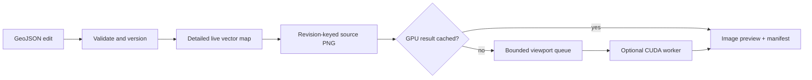

The saved vectors are authoritative. AI images can distort text or coastlines and
are currently previews. Exact production imagery needs mask compositing, coherent
metatiles and vector labels/roads after styling. The local server is an integration
reference, not an authenticated multi-user production service.

## Optional local GPU worker

Install a PyTorch build compatible with your GPU/driver, then the extra dependencies:

```sh
python -m pip install -e ".[gpu]"
python download_model.py
python -m uvicorn pod_server:app --host 127.0.0.1 --port 8888 --workers 1
```

The model downloader pins the upstream revision and verifies LFS weight hashes.
Model files live under `.cache/models/` and are excluded from Git. Set
`ZOOM_TILE_MODEL_CACHE` to a different cache root if needed. Model downloads are
several GiB and the downloader defaults to a 12 GiB free-space reserve.

The validated low-VRAM profile was an NVIDIA GTX 1060 6 GB, Python 3.12 and a
CUDA 12.6 PyTorch build. Defaults are 256px, 20 steps, sliced attention and sequential
CPU offload. This is a tested configuration, not a promise that every current
PyTorch wheel supports Pascal GPUs. Keep one model worker per GPU.

`GET /health` reports readiness. `POST /edit` takes source/context images, a style
prompt, z/x/y, seed/steps and optional world revision/hash. It returns a PNG plus
provenance. One inference runs at a time; overlapping direct calls return 429.
Do not expose this unauthenticated localhost prototype directly to the internet.

## Animations and editing assets

- **Don't just make a map. Make every level.** The 36-second isometric explainer
  shows nested tiles, detail informed by surrounding tiles, and a continuous
  zoom from region to street. It comes in original and aligned widescreen
  layouts with local recording and export. [Animation guide](docs/ANIMATIONS.md)
- **What are zoom tiles?** The 76-second introduction follows a bridge and
  river through successive zoom levels and includes real footage from the
  illustrated science atlas. Its local render workflow produces six 1080p30
  clips, a Final Cut Pro timeline, captions, narration and sound cues, and
  an OBS recording script. [Intro production guide](content/zoom-tiles-intro/README.md)

The Napknstack black-and-orange palette carries across the World Explorer,
Earth editing lab, context and results viewers, and explainer graphics.

## Recorded Earth examples and tests

[Open the example gallery](docs/GALLERY.md) for **11 scenarios and 22 actual
browser screenshots**, with before/after JSON and machine-readable results.
All edits are fictional. Five original named Great Lakes outline features are
public Natural Earth data; Michigan and Huron already touch in that source,
so the named-lake count differs from its connected-component count.

```sh
python scripts/generate_examples.py
python -m unittest discover -s tests
node tests/test_labels.mjs
node tests/test_detail_rendering.mjs
```

Three actual low-step GPU PNGs and two model-checker rejections are recorded alongside the geometry examples. The low-step images have visibly degraded colors/text and are not approved map imagery. The safety checker stays enabled.

Core tests run without CUDA. Worker/downloader contract tests use mocked inference
and skip when their optional dependencies are absent. Real GPU examples are
recorded separately and never fabricated from mock outputs. See
[recording instructions](docs/RECORDING.md) and [architecture](docs/ARCHITECTURE.md).

Observed development measurements: one uncached source preview ~0.67 seconds,
warm source preview ~1-3 ms, four-step AI draft ~14 seconds, twenty-step mosaic
~63 seconds, identical cached mosaic ~0.1 seconds. These are individual local
measurements, not frame-rate or production latency guarantees.

## Integration and current limits

Use `zoom_tiles.normalize_geography()` in your backend validation layer. Replace
the demo's local JSON/history and in-process jobs with your application's versioned
database, durable broker, permissions and object storage. Preserve optimistic
revision checks, immutable artifact hashes and the draft/apply boundary.

The current GPU cache includes the global world hash: a distant edit can invalidate
otherwise reusable tiles. Regional dependency hashes, affected-area-only planning,
shared CDN artifacts, durable retries and fair scheduling are the main scaling
improvements. Queued jobs do not survive a server restart. The camera can move
interactively while uncached AI jobs remain asynchronous.

The demo does not invent road networks or terrain semantics for newly exposed
lakebeds, rebuild routing/hydrology, or guarantee cross-tile AI seams. Those need
separate data-generation and quality gates.

## License and privacy

Original project code is MIT licensed. Third-party code, styles, map data and model
assets retain their own terms; see [THIRD_PARTY_NOTICES.md](THIRD_PARTY_NOTICES.md).
Map screenshots retain basemap attribution. Runtime state, local credentials,
models, databases and machine-specific coordination files are excluded from Git.
No telemetry service or paid image API is required by this project.
