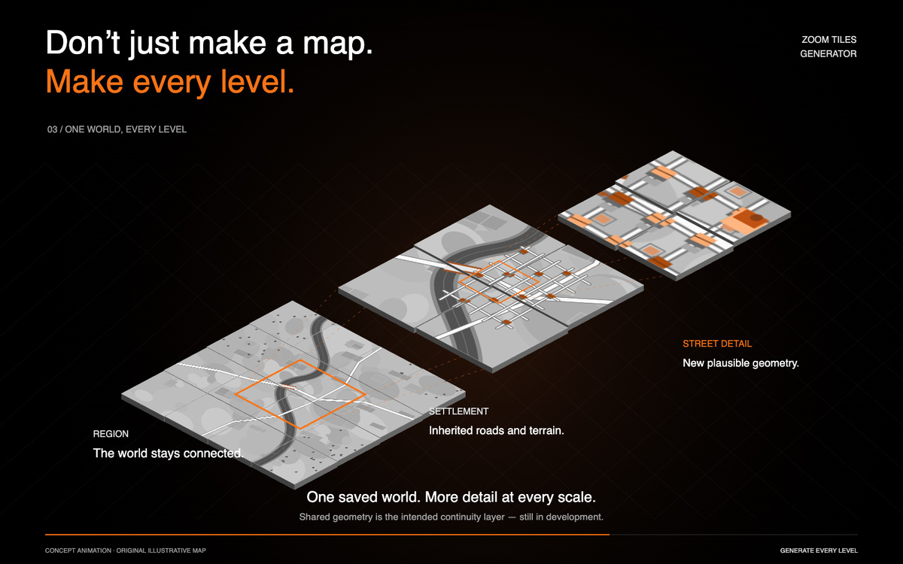
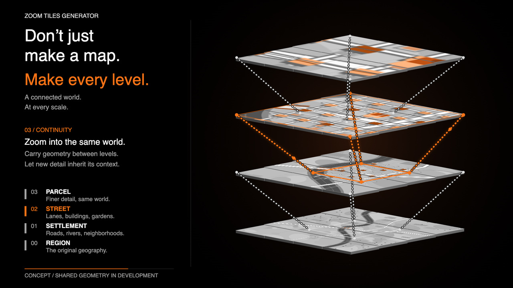

# Don't just make a map. Make every level.

A 36-second isometric explainer, with three reusable 10-second chapters and an
end card. All map art is original procedural vector illustration; no basemap,
Middle-earth artwork, image-generation API, model weights or CDN is required.



## Chapters

1. **Tiles within tiles** (0–10s): a continuous map divides from one tile into four,
   then sixteen. Roads, river and terrain stay aligned as the seams open.
2. **Context becomes detail** (10–20s): eight neighboring tiles, place research and
   a user's “More gardens” direction feed a missing central tile. The new draft
   reveals its detail and settles into the grid.
3. **One world, every level** (20–30s): an exploded isometric hierarchy links a
   regional map to a settlement and then a street-scale crop. Shared locations
   connect the levels; the geometry is an illustration of the intended system.
4. **End card** (30–36s): “Don't just make a map. Make every level.”

The animation is explanatory artwork, not a live model recording. The page and
third chapter explicitly distinguish the current raster-draft pipeline from the
planned persistent generated-geometry layer. Research and user inputs in the
animation are illustrative; they make no canonical geographic claim.

## Preview and export

### Aligned stack variation



Open `animation-stacked.html` for the 1920×1080 widescreen variation. Four
horizontal isometric layers share exactly the same x-axis, scale and inclination,
stacked one above another. Their source crops progress from region to settlement,
street and parcel. Every headline, caption and level label stays in the left
column throughout the animation; no text floats beside the maps.

Inter-level connectors use bright, rounded dots and visible endpoint markers in
both states. Highlighted links increase the dot weight and animate larger markers;
dark underlays preserve contrast where the connectors cross the map artwork.

It preserves the three chapters and the headline, with context arriving from
surrounding tiles and a parent level. The original animation remains available.
Both variations reuse `animation-art.js` for the same deterministic map artwork.

Record using **Record aligned variation**, then export independently:

```sh
python scripts/export_animation.py --variant stacked
```

Outputs live in `.runtime/animations/stacked/`; the original movie is preserved.

### Original variation

```sh
python scripts/serve_animation.py
# http://127.0.0.1:8793/animation.html
```

Pause, replay, scrub the timeline or jump to a chapter. Reduced-motion preferences
start the animation paused. The canvas is fixed at 1600×1000 and the surrounding
page adapts to smaller screens.

Select **Record full animation** to capture a 30fps WebM and two PNG posters in
`.runtime/animations/`. The loopback server accepts only the three named outputs
from its same-origin page and limits each upload to 80MB. Recording temporarily
locks playback controls. It does not capture the desktop, microphone or webcam.

With FFmpeg on PATH:

```sh
python scripts/export_animation.py
```

This creates a browser-friendly H.264 MP4 plus separate chapter MP4s. Rendering
source is committed; generated recordings stay in ignored runtime storage.
`animation.js` contains the map palette, timing, geometry and all three scenes.
No third-party animation library is required. See
[context and generation](CONTEXT_AND_GENERATION.md) for the engineering details.
