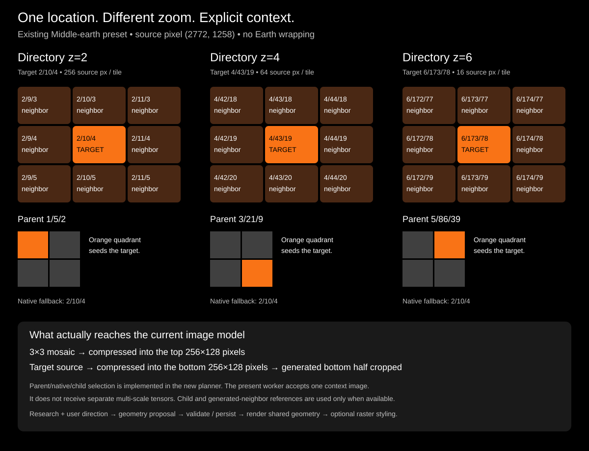
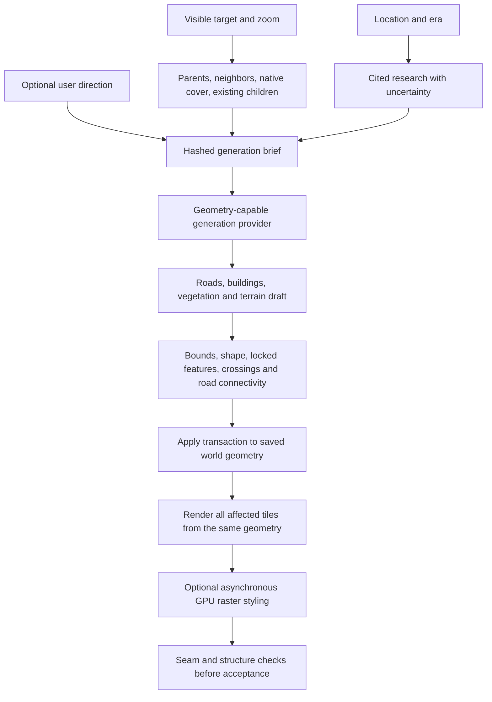

# Generating detail from context



The application already supports Middle-earth through a **pixel-space pyramid**.
Its supplied preset is 7680×4386 pixels, native directory zooms 0–2, extended
zooms −2–8. A single-resolution image can use the same coordinate adapter with
one native level. Extra zoom levels alone are magnification; new content needs
generation and a persistent world model.

## What selects the context

`zoom_tiles.pyramid.plan_context()` matches the supplied application grid math:

```
source_pixels_per_tile = 256 * 2 ** (native_max_z - directory_z)
x = floor(source_pixel_x / source_pixels_per_tile)
y = floor(source_pixel_y / source_pixels_per_tile)
```

For the supplied Shire pin (2772,1258), the target is **2/10/4**, **4/43/19** or
**6/173/78**. These are rectangular image coordinates. Do not require x/y < 2^z,
wrap longitude, or reinterpret them as Earth latitude/longitude.

| Context | Why it helps | Selection and fallback |
|---|---|---|
| Up to 8 same-zoom neighbors | Continue roads, water, terrain and style at edges | Bound by image grid; missing generated imagery falls back to native/ancestor crops |
| Up to 3 ancestors | Preserve regional structure as the user zooms | Exact quadrant crop in the parent; nearest available accepted ancestor preferred by host resolver |
| Native coverage | Keep evidence from the original map | Direct source coverage; never called newly generated detail |
| Up to 4 existing children | Respect detail already established during an earlier visit | Use available artifacts; never recursively generate children just to provide context |
| Research and user direction | Decide what belongs in this place | Cited claims, era, uncertainty and user preferences retained in a hashed generation brief |

The local lab resolves native-derived source and neighbor imagery and saves
the parent separately. Approved ancestor and child artifacts need a resolver
in the host application.

## What the current GPU sees

The Earth demo's `buildMosaicPng()` selects a same-zoom **3×3** neighborhood. It
wraps x for Earth and clips y at the poles. The new pixel-space adapter clips both
axes and never wraps. Both can send the resulting mosaic as
`context_mosaic_base64`.

`pod_server.compose()` currently compresses that mosaic into the **top half of
a 256×256 image** and the target into the bottom half. InstructPix2Pix edits the
whole input; the worker returns its bottom half, resized to 256×256. Thus the
target has only 256×128 working pixels and broad context loses substantial detail.
This is a tested integration mechanism, not true multi-scale conditioning or an
edge-continuity guarantee. Parent and child references in a plan are not
automatically separate inputs to this model.

## Research, inferred geometry and user instructions

**Prompt budget matters.** The current CLIP tokenizer accepts 77 tokens. In the
first comparison, a long research/style prefix pushed the user's direction out
of that window; two different requests returned byte-identical outputs. The
worker now rejects over-budget prompts with HTTP 422. The lab puts a compact
user direction first and retains the complete cited research in the separate
brief. A production planner must explicitly summarize research for each model's
input budget; it must not append arbitrary retrieved pages to an image prompt.

The intended flow is:



For the Shire example, the recorded research references Hobbiton/Bywater roads,
dwellings, a bridge and mill. The pack's **Shire pin is regional**, not a surveyed
Hobbiton location. A generated street layout there is speculative; the citations
do not establish exact footprints. `research.json` distinguishes cited claims
from layout inference. User direction can request a denser village or more gardens.
Contradictions should be recorded as an intentional alternative world rather than
silently rewriting the research.

The model should first propose shared geometry in **source pixels**, with stable
feature IDs, confidence, evidence IDs and `source`/`inferred`/`user` provenance.
`validate_geometry_proposal()` now checks shapes, extent and locked-feature
preservation. It does **not** yet check road connectivity, bridges, terrain
appropriateness or hydrology. No geometry-generation provider is connected in
this patch. The current GPU produces pixels, not GeoJSON.

Persist accepted geometry once per region/revision. Zooming then reveals more
of that same world. Do not independently reinvent streets on each tile request.
Neighbor tiles must share boundary junctions, and children must inherit parent
constraints. Keep names and important roads as vector overlays after styling.

## Running the supplied Middle-earth case

```sh
python scripts/pyramid_lab.py --case shire-context --z 4 --x 43 --y 19 --steps 20
python scripts/pyramid_lab.py --case shire-gardens --direction "More gardens and fewer dwellings; narrow footpaths, no dense town center." --steps 20
python scripts/render_context_docs.py
```

To use the interactive documentation locally, serve the docs directory with
`python -m http.server 8792 --bind 127.0.0.1 --directory docs` and open
`http://127.0.0.1:8792/context-explorer.html`.

The lab uses the application's actual upstream tiles and localhost GPU. It saves
source, 3×3 mosaic, parent reference, research brief, model result and manifest in
ignored `.runtime/pyramid/`. Native artwork stays out of the distributable package.
The original fan-map attribution and uncertain underlying rights are retained;
repository privacy remains unchanged.

## Application integration and remaining work

Send `coordinate_space: "pixel"` and the preset’s `map_geometry` for pixel-space
worker requests. Slippy requests use the existing coordinate validation.

Production work remains: a geometry-capable provider, evidence retrieval at run
time, durable region proposals and optimistic apply, approved-artifact context
resolution, shared edge constraints, mask-guided styling, vector label recovery
for baked raster text, and quantitative seam/geometry acceptance tests. The local
1060 worker is asynchronous; cached rendering can remain interactive, but a cold
model result should not block map navigation or be billed repeatedly after retries.

Each immutable artifact key must include world/region revision, coordinate space,
geometry, target, context artifact hashes, research version, user direction, seed,
model revision and pipeline version. A change in any dependency creates a new
draft; a stale result must never overwrite a newer world.
